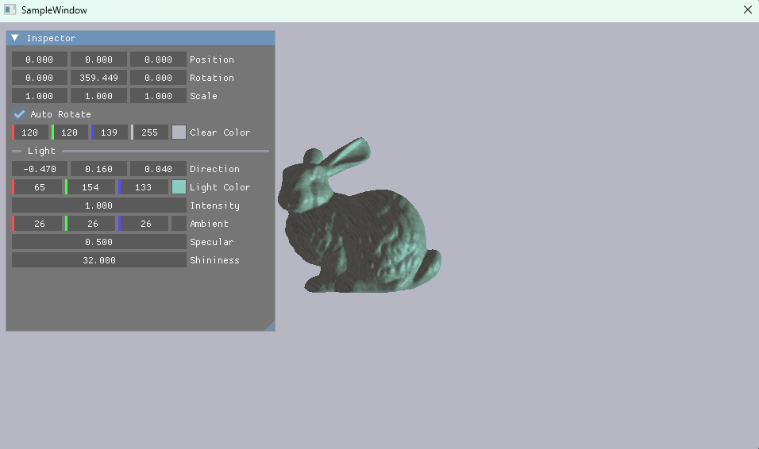
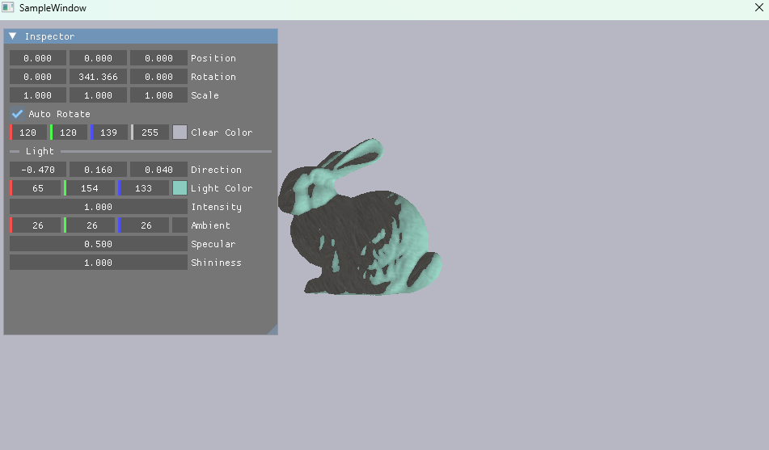
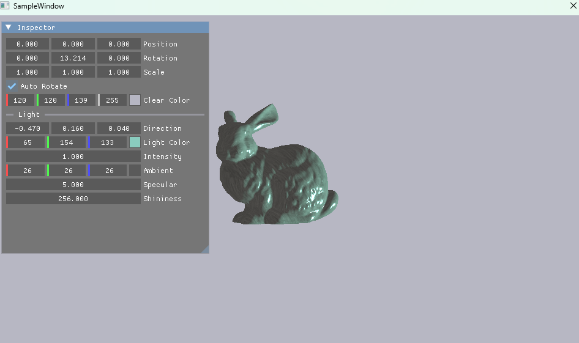
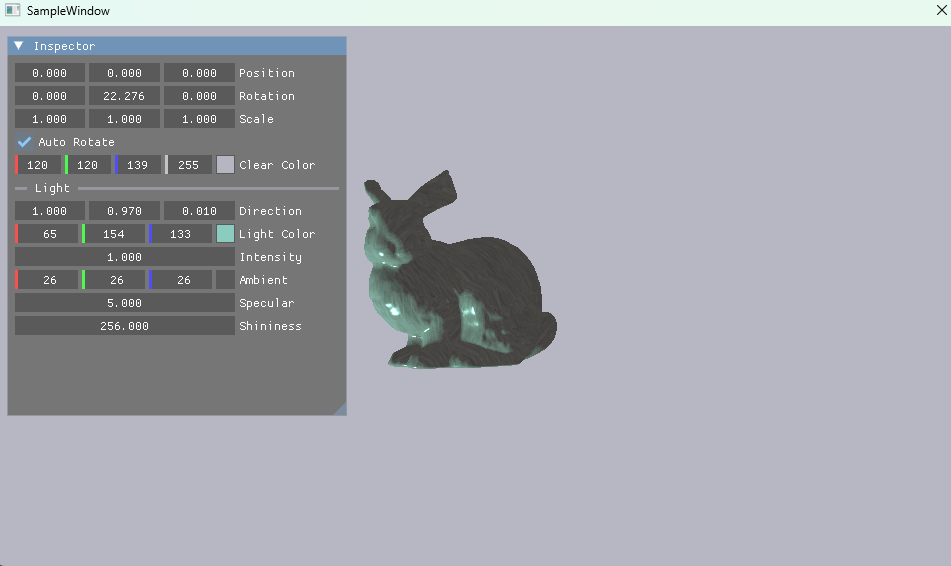

# 010 ライティング（平行光源）

## 手法
### 計算するライティング
- 平行光源1つで、次の3つを足し合わせた。
  1. **環境光（Ambient）**：光が当たらない面が真っ黒にならないよう、一定の明るさを足す
  2. **拡散反射（Lambert）**：光の方向に正面を向いている面ほど明るい
  3. **鏡面反射（Blinn-Phong）**：光の反射がカメラに向かうところにハイライトが出る

### 法線の変換
- 法線はワールド行列そのままではなく、**ワールド行列の逆行列の転置**（`WorldInvTrans`）で変換する。拡大率が XYZ でばらばらだと、そのまま変換した法線は面に垂直でなくなるため。
- 法線は向きだけを表すので、w = 0 にして平行移動の影響を受けないようにする。

### ピクセルシェーダの計算
| 記号 | 意味 | 求め方 |
|---|---|---|
| N | 法線 | VS から受け取り、`normalize` し直す（補間で長さが1でなくなる） |
| L | 光が来る方向 | `normalize(-LightDir)` |
| V | カメラへの方向 | `normalize(CameraPos - WorldPos)` |
| H | ハーフベクトル | `normalize(L + V)` |

- 拡散反射 = 色 × 光の色 × 強さ × `saturate(dot(N, L))`
- 鏡面反射 = 光の色 × 強さ × 鏡面の強さ × `pow(saturate(dot(N, H)), Shininess)`（光が当たっていない面では0）
- 最終色 = 環境光 + 拡散反射 + 鏡面反射

### ライトの定数バッファ（ルートCBV）
- ライトの値は、新しい定数バッファ `LightParam`（PS の `b1`）で渡す。
- 変換行列の CBV はディスクリプタヒープに置いてテーブルで渡しているが、ライトは **ルートCBV**（GPU アドレスを直接ルートシグニチャに渡す方式）にした。ヒープの枠を増やさずに済む。
- HLSL の定数バッファは16バイト（float4）単位で並ぶので、`float3 + float` を1組にして C++ 側と並びをそろえた。

### ルートシグニチャ
- ルートパラメータの番号には、`App.h` の `enum RootParam` で名前を付けた。作るとき（`CreateRootSignature`）と使うとき（`Render`）で番号がずれないようにするため。

| 番号 | 種類 | レジスタ | 使うシェーダ |
|---|---|---|---|
| `RootParam_Transform` | ディスクリプタテーブル（CBV） | `b0` 変換行列 | VS |
| `RootParam_Texture` | ディスクリプタテーブル（SRV） | `t0` テクスチャ | PS |
| `RootParam_Light` | **ルートCBV（追加）** | **`b1` `LightParam`** | PS |

### モデルとテクスチャ
- 球だけでは陰影が分かりにくいので、モデルをスタンフォードバニー（`res/model/stanford-bunny.obj`）にした。
- テクスチャは、次の順で決める。
  1. モデルの `.mtl` に `map_Kd` でテクスチャが指定されていれば、それを使う
  2. 指定が無い・見つからないときは、既定のテクスチャ（`res/texture/bunny_fur.dds`、白い毛並み）を使う
- 拡張子が `.dds` なら DDS として、それ以外（PNG・JPG・BMP）は WIC（Windows の画像読み込み機能）で読む。DDS に変換しなくても一般的な画像を使える。

## 前と比べてできるようになったこと
- 光の向きによって、面の明るさとハイライトが変わるようになった。
- Inspector から、ライトの向き・色・強さ、環境光、鏡面反射の強さと鋭さを変えられるようになった。
- スタンフォードバニーのような、頂点数の多いモデル（頂点 約3.5万個）を読み込めるようになった。
- PNG・JPG のテクスチャをそのまま使えるようになった。モデルの `.mtl` に書かれたテクスチャも読めるようになった。

## この章で新しく学んだこと
### Ambient・Specular・Shininess の意味
| パラメータ | 意味 | 値を変えると |
|---|---|---|
| **Ambient**（環境光の色） | 周りから回り込んでくる光を、簡単に一定の明るさとして足したもの | 大きくすると、光が当たらない面も明るくなる |
| **Specular**（鏡面反射の強さ） | ハイライトの明るさ | 0 にするとハイライトが消え、つやのない見た目になる |
| **Shininess**（鏡面反射の鋭さ） | ハイライトの広がり方 | 大きいほどハイライトが小さく鋭くなり、つるつるした見た目になる |

### そのほか
- 法線の変換に「逆行列の転置」が必要な理由（拡大率が XYZ でばらばらだと、面に垂直でなくなる）。
- ルートCBV はヒープが不要で手軽だが、ルートシグニチャの容量（64 DWORD）を2 DWORD 使う。テーブルは1 DWORD。
- 定数バッファの16バイト境界（`packoffset` の `c0.w` のような指定）。
- モデルに UV が無いと、全部の頂点がテクスチャの同じ1点を読むので、1色で塗られる。

## 詰まったこと
- バニーにテクスチャが貼られず、1色になった。
  → モデルに UV（`vt`）が入っていなかった。Blender の「スマート UV 投影」で UV を作って書き出し直した。
- バニーの表面がカクカクして見えた。
  → 法線が面ごとに1つ（フラットシェード）になっていた。Blender で「スムーズシェード」にして書き出し直した。
- シェーダのビルドで `error X3000: Illegal character in shader file` が出た。
  → `.hlsl` を UTF-8（BOM 付き）で保存していた。シェーダコンパイラ（fxc）は BOM を読めないので、BOM 無しにした。

## 今後の課題
- 点光源（距離による減衰）を追加する。
- マテリアル（`Material` の Diffuse・Specular・Shininess）を、ファイルから読んだ値で使う。
- 法線マップ（`Tangent` を使う）。
- ライトの色・強さを、物理ベース（PBR）の考え方に置き換える。
