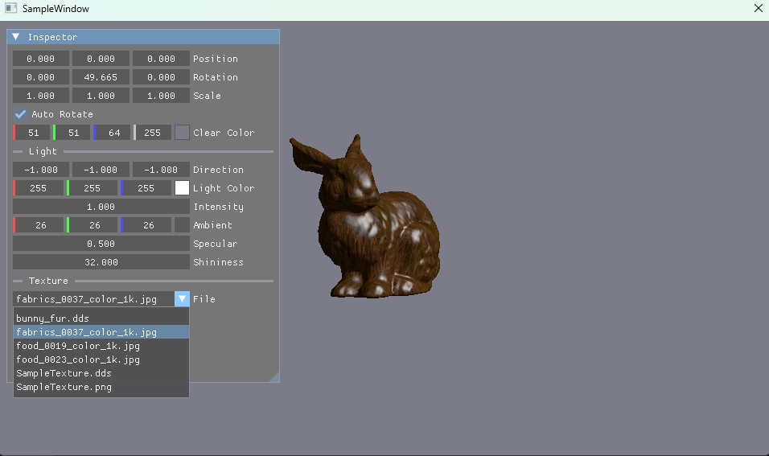
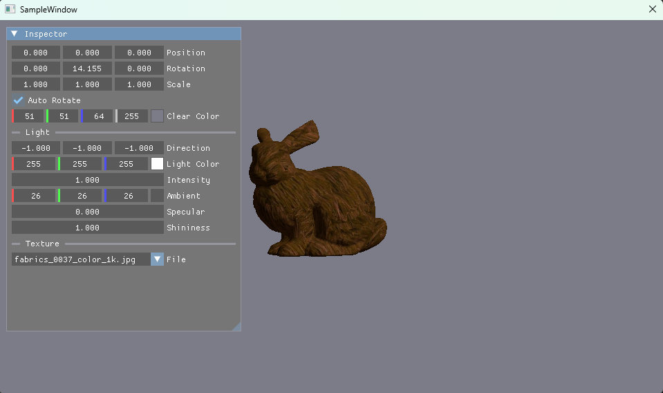

# 011 テクスチャの貼り替え（Inspector）

## 手法
- この章は描画の表現ではなく、エディタの機能（実行中のリソースの差し替え）の章。シェーダーは 010 から変えていない。

### 予約してから、次のフレームの最初に貼り替える
- `DrawImGui` はコマンドの記録の途中で呼ばれるので、そこで SRV を書き換えると今のフレームの描画が壊れる。
- そこで Inspector では「どれに替えるか」を予約（`m_PendingTexture`）するだけにした。
- 実際の貼り替えは、次のフレームの `Render` の最初（コマンドの記録を始める前）に `ApplyPendingTexture` で行う。

### GPU が使い終わるのを待ってから解放する
- フレームリソースが2つあるので、CPU が次のフレームを作っている間も、GPU は前のフレームで古いテクスチャを読んでいることがある。
- 貼り替えの前に `WaitGpu()` で GPU の処理が終わるのを待ち、それから古いテクスチャを解放する。

### SRV の場所は変えない
- 新しいテクスチャの SRV は、ヒープの同じ場所（`[FrameCount]` 番目）に作り直す。
- 場所が変わらないので、描画側（`m_HandleGPU_SRV`）とルートシグニチャは変更していない。

### 起動時と貼り替え時で同じ処理を使う
- 読み込みと SRV の作成を `LoadTextureResource`（`App_Texture.cpp`）にまとめ、起動時（`LoadTexture`）と貼り替え時（`ApplyPendingTexture`）の両方から呼ぶ。
- 新しいテクスチャは一時的な変数に読み込み、成功したときだけ入れ替える。読み込みに失敗しても、今のテクスチャはそのまま残る。

### 画像の一覧を作る
- 起動時に、今のテクスチャと同じフォルダ（`res/texture/`）にある画像（DDS・PNG・JPG・BMP）を一覧にして、Inspector のコンボボックスに表示する。
- プロジェクトの設定が C++14 なので、`std::filesystem`（C++17 から）ではなく、Windows の `FindFirstFileW` / `FindNextFileW` でファイルを探した。

## 前と比べてできるようになったこと
- 実行中に Inspector からテクスチャを選んで、すぐに貼り替えられるようになった。
- 壊れた画像を選んでも、今のテクスチャのまま動き続けるようになった。

## この章で新しく学んだこと
- GPU は CPU より遅れて描画しているので、実行中にリソースを差し替えるときは、GPU が使い終わるのを待ってから解放する必要がある。
- ディスクリプタ（SRV）は、ヒープの同じ場所に作り直せば、描画側を変えずに中身だけ差し替えられる。
- ImGui の操作は「予約」にして、実際の変更はコマンドの記録の外で行うと安全。
- ImGui の標準フォントには日本語の文字が無いので、日本語のファイル名は「?」で表示される。

## 今後の課題
- 実行中にフォルダへ追加した画像は一覧に出ないので、一覧を作り直すボタンを付ける。
- ファイルをウィンドウにドラッグ＆ドロップして貼り替えられるようにする。
