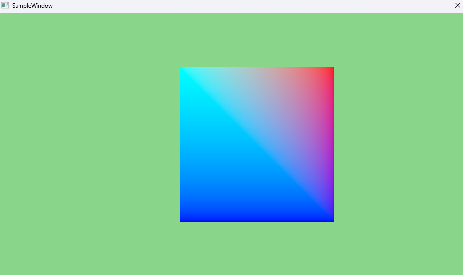
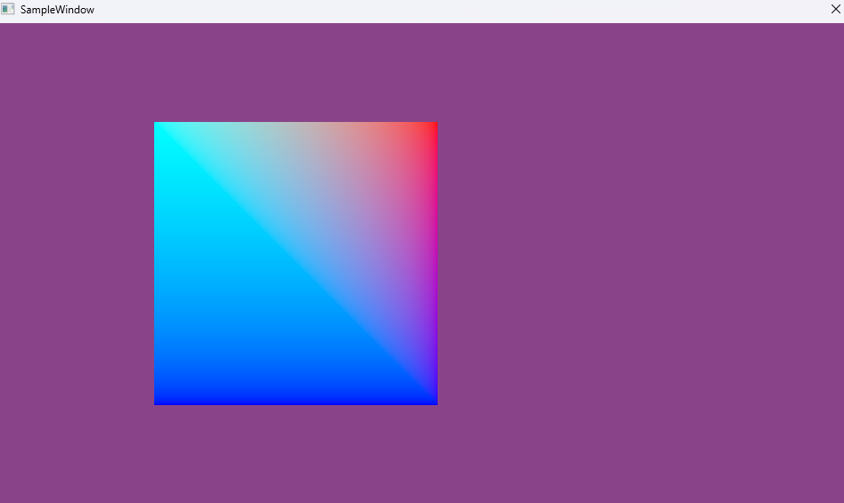

# 003 定数バッファを用いて移動を描画する

## 手法
- インデックスバッファ（頂点4個・インデックス6個）で描いた四角形を、時間に合わせて左右に往復させた。
- 定数バッファを、2種類の方法でシェーダーに渡した。
  - `b0`：`Transform`（World / View / Proj 行列）を **ルートCBV** で渡す
    - `SetGraphicsRootConstantBufferView(0, m_pCB[m_FrameIndex]->GetGPUVirtualAddress())`
  - `b1`：`MoveParam`（`OffsetX`）を **ルート定数** で渡す
    - `SetGraphicsRoot32BitConstants(1, sizeof(MoveParam) / 4, &m_MoveParam, 0)`
- 毎フレーム `OffsetX = sinf(経過時間)` を計算し、頂点シェーダーで `localPos.x += OffsetX` としてずらした。
- ルートシグニチャのパラメータを2つにした。

  | パラメータ | 種類 | レジスタ |
  |---|---|---|
  | `params[0]` | `D3D12_ROOT_PARAMETER_TYPE_CBV`（ルートCBV） | `b0` |
  | `params[1]` | `D3D12_ROOT_PARAMETER_TYPE_32BIT_CONSTANTS`（ルート定数、`Num32BitValues = sizeof(MoveParam) / 4` = 1） | `b1` |

## 前と比べてできるようになったこと
- CPU で計算した値をシェーダーに渡して、図形を動かせるようになった。
- 定数バッファで World / View / Proj 行列を渡し、3D の座標変換をシェーダーで行えるようになった。

## この章で新しく学んだこと
- **ルートCBV** はバッファ（リソース）の GPU アドレスを渡す。中身は Map したメモリに書き込む。
- **ルート定数** は値そのものをルートシグニチャに直接書き込む。バッファもディスクリプタも要らないが、使える量は少ない。
- 定数バッファのサイズは256バイト境界にそろえる必要がある（`struct alignas(256) Transform`）。
- `Num32BitValues` は「32bit の値が何個か」なので、`sizeof(MoveParam) / 4` になる。
- 頂点シェーダーで位置を変えても、CPU から渡した元の頂点データは変わらない。毎フレーム同じ頂点データから計算される。
- ルートシグニチャ全体の大きさには上限（64 DWORD）がある。ルート定数は1値で1 DWORD、ルートCBV は1つで2 DWORD、ディスクリプタテーブルは1つで1 DWORD を使う。

### 定数バッファの渡し方は3つある
| 渡し方 | ルートに置くもの | 必要なもの | 向いている用途 |
|--------|------------------|------------|----------------|
| ルート定数（`32BIT_CONSTANTS`） | 値そのもの | なし（バッファもディスクリプタも不要） | 数個の小さな値（今回の `OffsetX`） |
| ルートCBV（`CBV`） | バッファの GPU アドレス | 定数バッファのリソース | 行列など、ある程度大きいデータ（今回の `Transform`） |
| ディスクリプタテーブル | ディスクリプタヒープ内の位置 | リソース＋ディスクリプタヒープ＋CBV の作成 | 多数のリソースをまとめて渡す。テクスチャ（SRV）はこの方法でしか渡せない |

- ディスクリプタテーブルで渡す場合、ヒープの種類は `CBV_SRV_UAV` なので、CBV と SRV・UAV を同じヒープに並べられる。

### 定数バッファの分け方の例
- 定数バッファは、用途や更新する頻度ごとに分けて使うことが多い。DirectX 12 に「種類」の決まりがあるわけではなく、下の表はよくある分け方の例（名前も決まったものではない）。
- 今回は World・View・Proj を1つの `Transform` にまとめている。

| 名前の例 | 格納するデータ | 何に使うのか |
|---|---|---|
| ObjectCB | World行列 | 物体の位置・回転・拡大縮小 |
| CameraCB | View行列, Projection行列, カメラ位置 | 3D空間を画面に映す |
| MaterialCB | 色, 金属度, 粗さ, 透明度 | 物体の材質や見た目を決める |
| LightCB | 光源位置, 光の方向, 色, 強度 | ライティング計算 |
| FrameCB | 経過時間, 画面サイズ | アニメーションや画面効果 |
| EffectCB | ぼかし強度, 波の高さ, 波の速さ | ポストエフェクトや水面表現 |

## 詰まったこと
- 定数バッファをシェーダーに渡す **3つの方法の違い** が分からなかった。
  → 「ルートシグニチャに何を置くか」で整理して理解した（上の表）。
