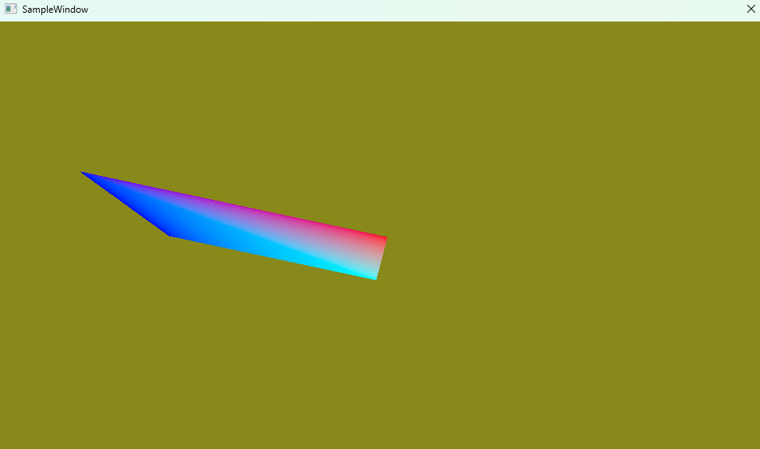
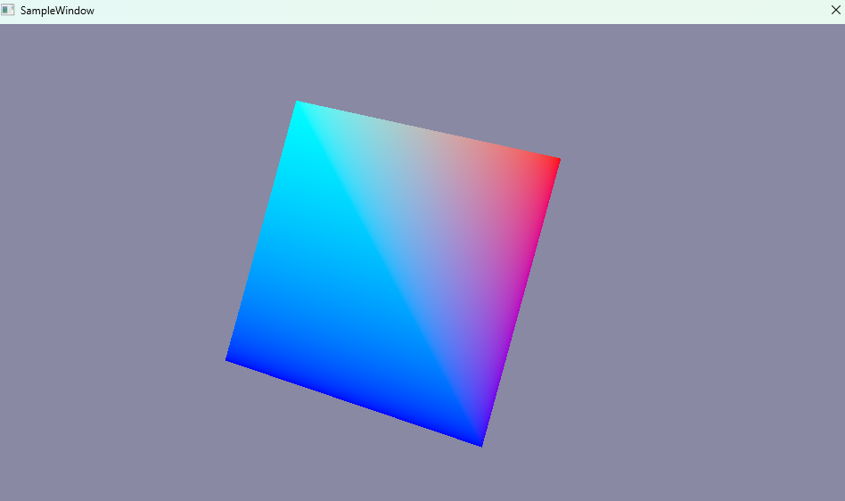

# 005 回転させる（行列の入門）




## 手法
- 004 の移動に、Y 軸と Z 軸の回転を加えた。経過時間 `t`（秒）をそのまま角度（ラジアン）として使う。

  ```cpp
  const float t = m_Timer.GetTotalTime();
  XMMATRIX rot1  = XMMatrixRotationY(t);                     // Y 軸まわりの回転
  XMMATRIX rot2  = XMMatrixRotationZ(t);                     // Z 軸まわりの回転
  XMMATRIX trans = XMMatrixTranslation(sinf(t), 0.0f, 0.0f); // 左右の往復
  m_pTransform[m_FrameIndex]->World = rot1 * rot2 * trans;
  ```
- 頂点シェーダーでは、`World` → `View` → `Proj` の順に掛けて画面上の位置を求める。

  ```hlsl
  float4 worldPos = mul(World, localPos);
  float4 viewPos  = mul(View, worldPos);
  float4 projPos  = mul(Proj, viewPos);
  ```

## 前と比べてできるようになったこと
- 移動だけでなく、回転も行列で表せるようになった。
- 複数の変換（回転・移動）を、行列の掛け算で1つの World 行列にまとめられるようになった。

## この章で新しく学んだこと
- DirectXMath では、行列は **左から順に** かかる。`rot1 * rot2 * trans` は「Y 回転 → Z 回転 → 移動」の順。
  - 先に回転してから移動するので、四角形は **自分の中心で** 回りながら左右に動く。
  - 逆に `trans * rot` にすると、移動したあとで原点まわりに回るので、**原点の周りを回る**（公転のような動き）になる。
- 回転の関数（`XMMatrixRotationY` など）が受け取る角度はラジアン。度で考えたいときは `XMConvertToRadians` で変換する。
- C++ 側で転置しなくても `mul(World, localPos)` で正しく計算できるのは、DirectXMath（行を基準に並べる）と HLSL（定数バッファの行列を列を基準に読む）の並べ方の違いで、シェーダーからは転置された行列に見えるため。この組み合わせでは、行列を左に置く `mul(行列, ベクトル)` が正しい。
