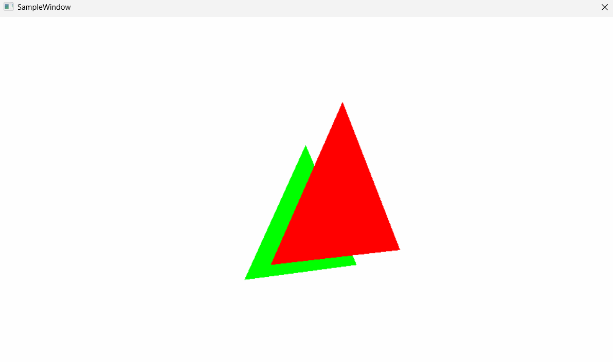
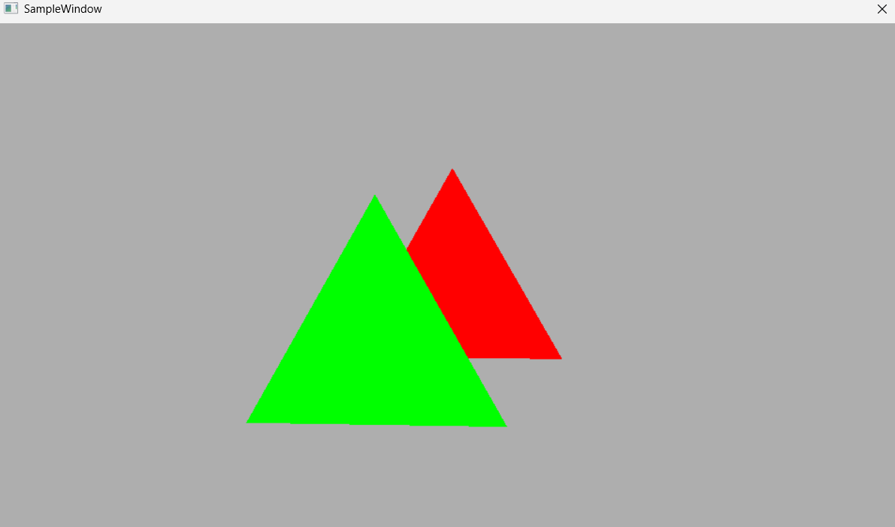

# 006 深度バッファを用いて2枚の図形を描画する

## 手法
- 1.深度の形式を決める(32bitの浮動小数点数),ステンシル成分自体は決定しない,深度の範囲自体はビューポートで決定
- 2.DSVヒープを1スロット決める.(深度画像が1枚の場合は1スロットのみ)
- 3.先頭のCPUハンドルを決める.(Direct3D 12 の API に渡す用)
- 4.深度画像を置くメモリの性質を決定.(1,どんなメモリに置くか(メモリの種類やノードの指定),2,どんな深度画像を作るか(サイズ,形式,サンプル数),3,最適化クリア値(この値でクリアすると最も速くなる値)は何か)
- 5.どんな深度画像を作るかの指定
## 前と比べてできるようになったこと
- 深度バッファを使って、重なった図形の前後関係を正しく描けるようになった。
- 深度バッファ用のディスクリプタヒープ（DSV）と、深度ステンシルステートを設定できるようになった（上の1〜5）。

## この章で新しく学んだこと
### 基本
- デプスバッファは、画面の各ピクセルに対応する「深度値」を保存する画像のこと
- 新しく描こうとする部分の深度と、保存済みの深度を比較し、手前にあるかを判定するのが深度テスト
- デプスバッファは1が遠く,0が近い（DirectXの標準設定。Reversed-Zでは逆になる）
- 深度の値と奥行きは非線形な関係（透視投影では深度値は 1/z に比例し、手前ほど精度が高い）

### 用途
- 主な用途は前後関係の正しい描画（隠面消去）。副次的に、隠れるピクセルの処理を省いて描画を効率化できる（Early-Z）
- 不透明物体の描画順序は結果に影響を与えないため、厳密な順序付けは不要.（ただし手前から描くとEarly-Zが効いて速くなる）
- デプスバッファはメモリアクセスのため,使いすぎると遅い(フルHDなら約200万ピクセル)

### 半透明描画
- 半透明描画は奥から描いていくとよい
- 前後関係を反映した半透明描画手法の研究が行われている
- デプスバッファは半透明描画に利用できる(シールド表現,ソフトパーティクル)
- 半透明描画は小さく描いて(解像度を落として),拡大しても意外と見た目じゃわからないため,この手法が重い半透明処理を扱う際に結構使われる.
- ディザリングという手法を用いて疑似的に半透明を使う手法もある.こちらは物体自体は不透明として描画される.

### DirectX 12での実装
- ディスクリプタヒープは4種類存在し,今回用いるDSVはその一つのため,事前に定数バッファ用ディスクリプタヒープを作っていたとしても新しく作る必要がある.

## 詰まったこと
- 深度バッファのNumDescriptorsを増やすのはどんなときなのか？
- ※複数のスロットが必要な場合というのは,深度画像が複数枚必要なカメラから見た深度とライトから見た影の深度を別々に保存する場合などの時,つまり,影を描画したいとき
