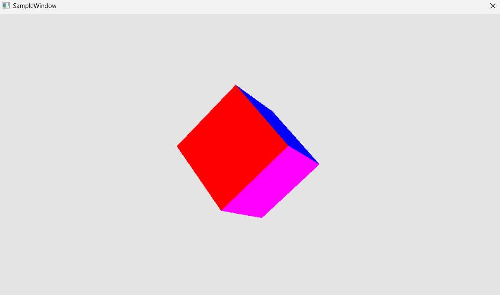
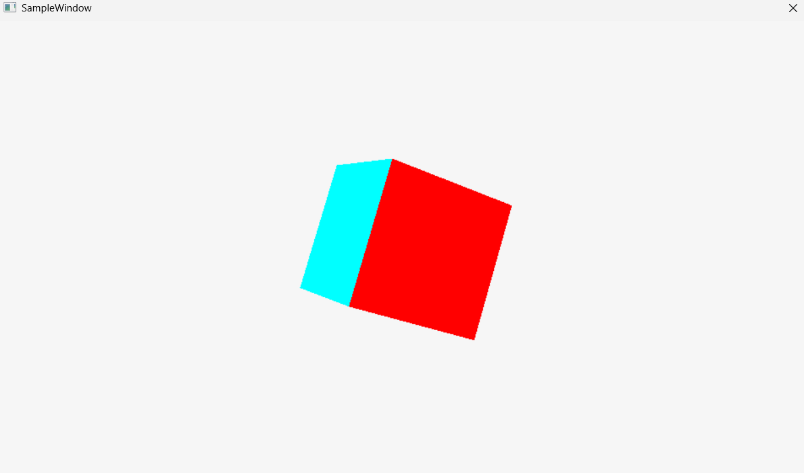
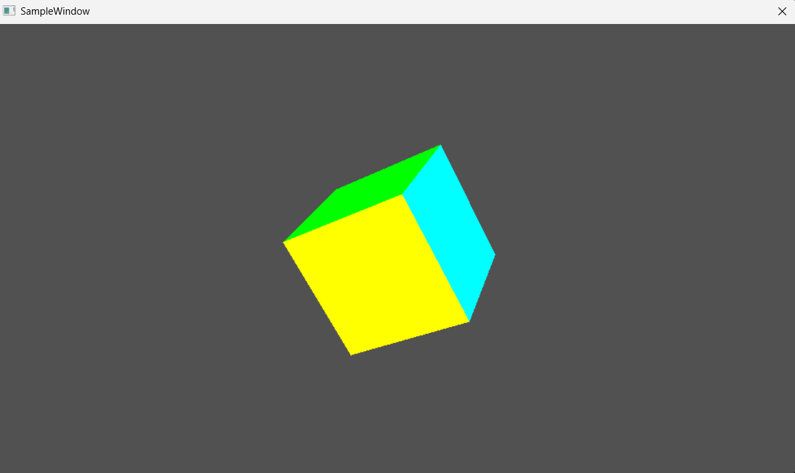

# 007 立方体を正確に描画する

## 手法
- 006 の深度バッファの仕組みはそのままに、描く形を四角形から立方体にした。
- 立方体の6つの面に別々の色を付けたいので、頂点は面ごとに4個ずつ、合計24個用意した。
  - 角の位置は8か所しかないが、同じ位置でも面によって色が違うので、頂点を共有できない。
- インデックスは1面あたり三角形2枚（6個）で、合計36個。
- Y 軸・Z 軸まわりに回転させて、いろいろな向きから立方体を見られるようにした。
- 背面カリングはしていない（`D3D12_CULL_MODE_NONE`）ので、奥の面も描かれる。正しく見えるのは、深度テスト（`LESS_EQUAL`）で奥の面が手前の面に隠されるため。

## 前と比べてできるようになったこと
- 平面の図形ではなく、奥行きのある立体を描けるようになった。
- 回転させても、面の前後関係が崩れずに表示されることを確認できた。

## この章で新しく学んだこと
- 頂点は「位置」だけでなく「色などの属性」まで含めて1つ。位置が同じでも属性が違えば、別の頂点として用意する必要がある。
- カリングをしなくても、深度テストがあれば前後関係は正しく描ける。ただし、見えない裏側の面も描くので、処理は無駄になる。
