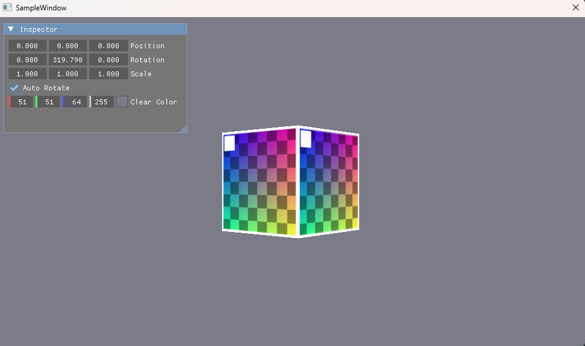
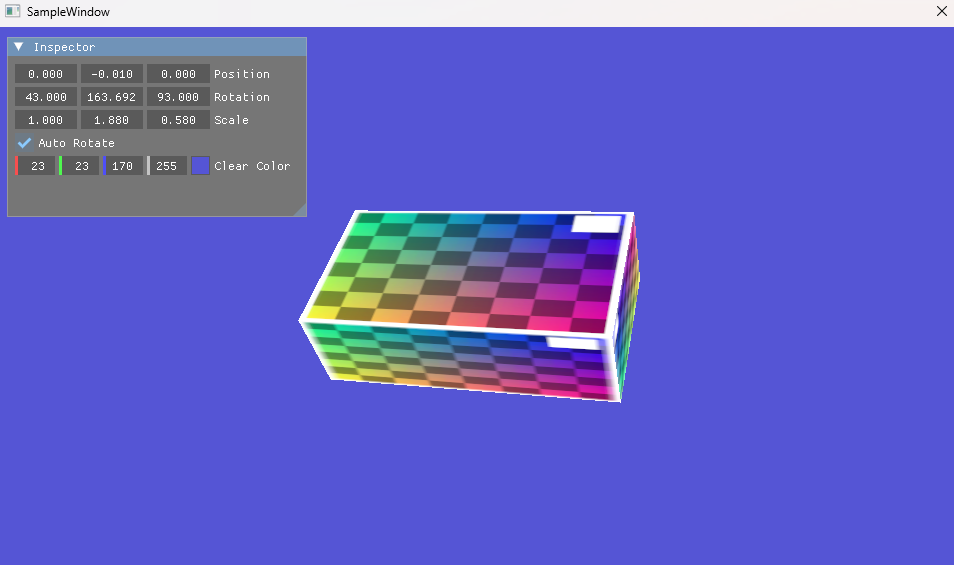
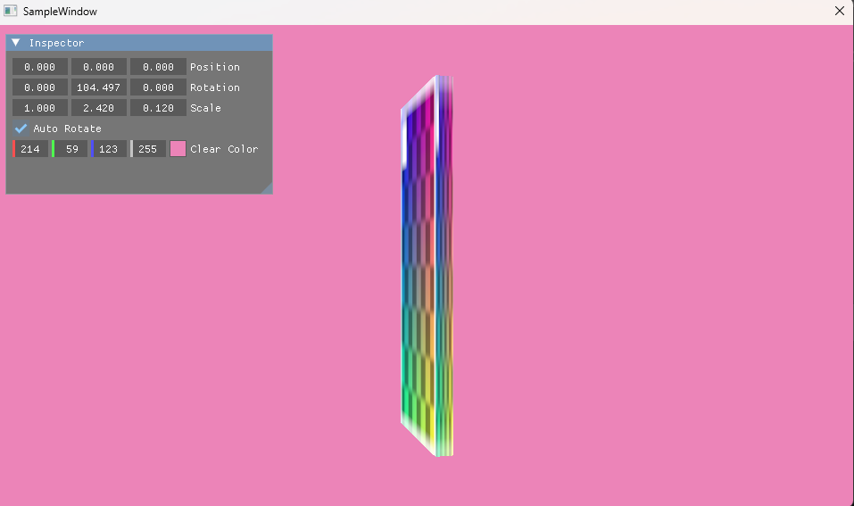

# 008 テクスチャの読み取りと貼り付け ＋ ImGui の実装





## 手法

### テクスチャ
- 画像の読み込みと GPU への転送には DirectXTK12（NuGet: directxtk12_desktop_2019）を使った。
- 画像は `res/texture/SampleTexture.dds`（256×256、ミップマップ9段、BC7 sRGB 形式）。
- 画像が GPU に届くまでの流れ：

  ```
  DDS ファイル → Upload ヒープ → Default ヒープのテクスチャ(m_pTexture)
              → SRV(ヒープの [2]) → ルートパラメータ1 → ピクセルシェーダの t0
  ```
- 頂点の色を UV（`XMFLOAT2 TexCoord`）に置き換え、各面の4頂点に (0,0)・(1,0)・(1,1)・(0,1) を割り当てた。
- 「どこを読むか」は頂点の UV、「どう読むか」は静的サンプラー `s0`（`MIN_MAG_MIP_LINEAR`・`CLAMP`）が決める。

### ディスクリプタヒープとルートシグニチャ
- 定数バッファの CBV とテクスチャの SRV を、1つの `CBV_SRV_UAV` ヒープ（`SHADER_VISIBLE`）に並べた。

  | ヒープ | 番号 | 中身 | シェーダーでの名前 |
  |---|---|---|---|
  | `m_pHeapCBV_SRV_UAV`（3枠） | [0] | CBV：フレーム0用 `Transform` | `b0` |
  | | [1] | CBV：フレーム1用 `Transform` | `b0` |
  | | [2] | SRV：`m_pTexture` | `t0` |
  | `m_pHeapImGui`（64枠） | [0]〜 | ImGui が使う SRV（フォントなど） | ImGui 内部 |

- ルートシグニチャは、パラメータ2つ＋静的サンプラー1つにした。

  | パラメータ | 種類 | レジスタ | 使うシェーダ |
  |---|---|---|---|
  | [0] | ディスクリプタテーブル（CBV 1個） | `b0` | VS |
  | [1] | ディスクリプタテーブル（SRV 1個） | `t0` | PS |
  | 静的サンプラー | — | `s0` | PS |

- 描画時は `SetDescriptorHeaps` → `SetGraphicsRootDescriptorTable(0, そのフレームの CBV)` → `SetGraphicsRootDescriptorTable(1, SRV)` の順に設定する。

### ImGui
- Dear ImGui（1.93.1 WIP）の本体に、`imgui_impl_win32`（入力・ウィンドウ）と `imgui_impl_dx12`（描画）のバックエンドを組み合わせた。
- ImGui 専用の SRV ヒープ（`m_pHeapImGui`、64枠）を、立方体用とは**別に**作った。空き枠は `SrvDescriptorAllocFn` のラムダで先頭から順に渡す。
- 毎フレームの順番：

  ```
  立方体を描く → ヒープを ImGui 用に切り替える → ImGui を描く → PRESENT へのバリア
  ```
- 入力は `WndProc` の先頭で `ImGui_ImplWin32_WndProcHandler` に渡す。
- 終了時は `WaitGpu` → `TermImGui` → `OnTerm` → `TermD3D` の順にし、デバイスより先に ImGui を片付ける。

### Inspector の値を描画に反映する
- ワールド行列を `拡大(S) × 回転(R) × 移動(T)` で組み立てて、定数バッファに書く。
- Auto Rotate が ON なら、`Timer` の経過時間を使って Y 軸の回転を1秒に60度ずつ進める。

## 前と比べてできるようになったこと
- 頂点の色ではなく、**画像（テクスチャ）を立方体の各面に貼れる**ようになった。
- 実行中に **Inspector ウィンドウから**、立方体の位置・回転・拡大率と背景色を変えられるようになった。

  | 項目 | ウィジェット | 変える変数 |
  |---|---|---|
  | Position | `DragFloat3` | `m_Position` |
  | Rotation | `DragFloat3`（度） | `m_RotationDeg` |
  | Scale | `DragFloat3`（0.01〜100） | `m_Scale` |
  | Auto Rotate | `Checkbox` | `m_AutoRotate` |
  | Clear Color | `ColorEdit4` | `m_ClearColor` |
- `Timer` クラスで経過時間を測り、フレームレートに左右されない速さで回転できるようになった。
- `App.cpp` を役割ごとの4ファイル（`App_Init` / `App_OnInit` / `App_Loop` / `App_Term`）に分け、見通しがよくなった。

## この章で新しく学んだこと

### テクスチャ
- SRV は画像そのものではなく、「この画像をどう読むか」の説明書き。画像本体はリソース（`m_pTexture`）。
- `params[1]` だから `register(t1)` になるわけではない。レジスタ番号は `BaseShaderRegister` で決まる。
- GPU ハンドルは「セットされたヒープ内の位置」なので、`SetDescriptorHeaps` を先に呼ぶ必要がある。
- RTV・DSV のヒープはシェーダーから見えなくてよいが、CBV・SRV のヒープは `SHADER_VISIBLE` が必要。
- CBV と SRV は1枠のサイズが同じなので、同じ `CBV_SRV_UAV` ヒープに並べられる。
- 静的サンプラーはルートシグニチャに埋め込むので、サンプラー用のヒープが要らない。
- 画像を sRGB として読み、RTV も `_SRGB` にすると、色が二重に補正されない。
- `ResourceUploadBatch` は、Upload → Default のコピーとリソースバリアを内部でまとめて行っている。

### ImGui
- ImGui は自前のルートシグニチャと PSO を持っているので、立方体用の設定とは関係なく描画される。
- `SetDescriptorHeaps` でセットできる `CBV_SRV_UAV` ヒープは1つだけ。そのため、立方体を描いたあと、ImGui を描く前にヒープを切り替える必要がある。
- ImGui の描画も、同じコマンドリストに積む描画命令の1つ。なので順番（立方体 → ImGui → `PRESENT` へのバリア）が大事。
- Win32 バックエンドに入力を渡さないと、表示はされてもクリックやドラッグが効かない。
- 終了時は、GPU が ImGui のリソースを使い終わるのを待ってから、デバイスより先に ImGui を片付ける。

## 詰まったこと
- `SimpleTexVS.hlsl` のセマンティクスを `POSITIONT` と誤記していた → `POSITION` に修正。
- `packoffset(b4)` と書いていた → 定数バッファ内の位置は `c` で指定するので、`packoffset(c4)` に修正。

## 今後の課題
- `ResourceUploadBatch` を使わず、Upload → Default のコピーを自前で書く。
- 面ごとに違う画像を貼る（サイコロなど）。
