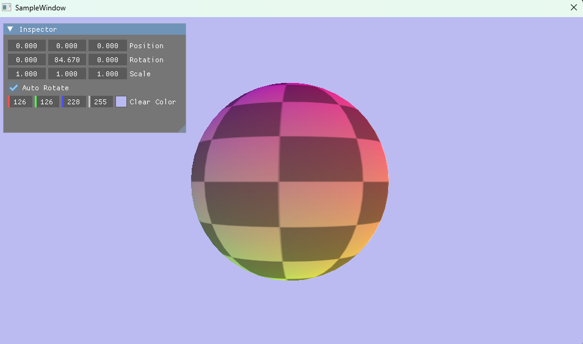
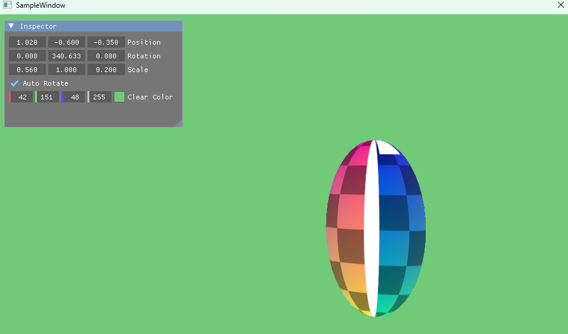

# 009 メッシュの読み込み（Assimp）




## 手法
### Assimp でモデルファイルを読む
- モデルの読み込みには Assimp を使った。vcpkg のマニフェストモード（`project/vcpkg.json`）で導入している。
- `Mesh.cpp` の `LoadMesh` が、Assimp で読んだデータ（`aiScene`）を、自分で定義した構造体に詰め替える。

  ```
  モデルファイル(.obj など) → Assimp(aiScene) → Mesh / Material(自作の構造体) → 頂点バッファ・インデックスバッファ
  ```
- 読み込むときに、Assimp に次の処理（ポストプロセス）を頼んでいる。

  | フラグ | 内容 |
  |---|---|
  | `aiProcess_Triangulate` | 四角形などをすべて三角形に分割する |
  | `aiProcess_PreTransformVertices` | ノードの行列を頂点に焼き込み、階層をなくす |
  | `aiProcess_CalcTangentSpace` | 接線を計算する |
  | `aiProcess_GenSmoothNormals` | 法線が無ければ、なめらかな法線を作る |
  | `aiProcess_FlipUVs` | UV の上下を反転する（OBJ などは下が v=0、DirectX は上が v=0） |
  | `aiProcess_OptimizeMeshes` | 細かいメッシュをまとめて、描画回数を減らす |

- Assimp はファイルパスを UTF-8（`char*`）でしか受け取れないので、`WideCharToMultiByte` で変換して渡す。

### 頂点の形式
- 頂点は `MeshVertex`（位置・法線・UV・接線の4要素、44バイト）にした。法線と接線は、この章ではまだ使っていない（ライティングと法線マップで使う）。
- 入力レイアウトは `MeshVertex::InputLayout` として `Mesh.cpp` にまとめ、PSO に渡す。各要素の位置は `D3D12_APPEND_ALIGNED_ELEMENT`（前の要素の続き）にした。
- 構造体の大きさが入力レイアウトとずれないように、`static_assert(sizeof(MeshVertex) == 44)` でビルド時に確かめる。

### 全メッシュを1本のバッファにまとめて描く
- モデルは複数のメッシュでできていることがあるので、全メッシュの頂点・インデックスを1本の頂点バッファ・インデックスバッファにまとめた。
- メッシュごとに「どこからどこまでを描くか」を `DrawRange` として覚えておき、範囲ごとに `DrawIndexedInstanced` を呼ぶ。

  | `DrawRange` のメンバー | 意味 |
  |---|---|
  | `IndexCount` | 描くインデックスの数 |
  | `StartIndex` | インデックスバッファの何番目から読むか |
  | `BaseVertex` | 読んだインデックスに足す値（そのメッシュの頂点の開始位置） |

- インデックスは `uint32_t`（`DXGI_FORMAT_R32_UINT`）にした。頂点数が 65,536 を超えるモデルも読めるようにするため。
- モデルの UV は 0〜1 の外にはみ出すことがあるので、サンプラーのアドレスモードを `CLAMP` から `WRAP`（繰り返し）に変えた。

## 前と比べてできるようになったこと
- コードに頂点を直接書かずに、**モデルファイル（.obj・.fbx・.gltf など）から形を読み込んで描けるようになった**。
- 複数のメッシュでできたモデルも描けるようになった。
- 今回は UV 球（`res/model/sphere.obj`、頂点 1,225 個・三角形 2,304 枚）を読み込み、008 のテクスチャを貼って表示した。

## この章で新しく学んだこと
- `BaseVertex` を使うと、各メッシュのインデックスを「そのメッシュの中での番号」のまま使える。まとめたバッファに合わせてインデックスを書き換える必要がない。
- 入力レイアウトは、C++ の頂点構造体と頂点シェーダーの入力（`VSInput`）の両方と、名前（セマンティクス）・型・順番をそろえる必要がある。
- `<codecvt>` は C++17 で非推奨になり、SDL チェックが ON だとエラーになるので、文字コードの変換には Windows API を使う。
- vcpkg で入れたライブラリの DLL は、**リンクしたときに** exe と同じフォルダへコピーされる。

## 詰まったこと
- 実行すると「`assimp-vc143-mtd.dll` が見つからないため、コードの実行を続行できません」と出た。
  → exe のフォルダから Assimp の DLL が消えていた。コードを変えていないと普通のビルドではリンクされず、DLL もコピーし直されない。「ソリューションのリビルド」で解決した。
